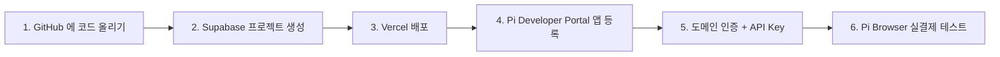

# VeriLens 배포 & Pi 연동 가이드

> 이 문서는 **직접 하셔야 하는 작업**을 순서대로 정리한 체크리스트입니다.
> 계정 생성·로그인·키 발급처럼 본인 인증이 필요한 단계는 AI 가 대신할 수 없습니다.
> 각 단계가 끝나면 표시된 값을 AI 에게 알려주시면 나머지 설정·테스트를 이어서 진행합니다.

## 전체 흐름

| 단계 | 소요 | 비용 | 직접 해야 하는 이유 |
|---|---|---|---|
| 1. GitHub | 10분 | 무료 | 본인 계정 |
| 2. Supabase | 10분 | 무료 플랜 | 본인 계정, 비밀키 |
| 3. Vercel | 10분 | 무료 플랜 | 본인 계정 |
| 4~5. Pi Developer Portal | 20분 | 무료 | **Pi 앱(Pi Browser) 로그인 + KYC 계정 필요** |
| 6. 실결제 테스트 | 10분 | Test-Pi | Pi 지갑 서명은 본인만 가능 |

---

## 1단계. GitHub 에 코드 올리기

1. https://github.com 가입 → 우측 상단 **+ → New repository**
2. 이름 `verilens`, **Private** 선택 → Create
3. PC 에 Git 설치: PowerShell 에서 `winget install --id Git.Git -e`
4. AI 에게 "GitHub 저장소 만들었어, 주소는 https://github.com/아이디/verilens" 라고 알려주시면 업로드 명령을 준비해 드립니다.
   (`.env.local` 과 `.data/` 는 `.gitignore` 에 있어 비밀값은 올라가지 않습니다)

## 2단계. Supabase (영구 저장소)

1. https://supabase.com → GitHub 로 로그인 → **New project**
   - Region: **Northeast Asia (Seoul)** 권장, DB 비밀번호는 안전하게 보관
2. 프로젝트 생성 후 왼쪽 **SQL Editor** → `supabase/schema.sql` 파일 내용 전체 붙여넣기 → **Run**
3. **Project Settings → API** 에서 두 값 복사
   - `Project URL` → `SUPABASE_URL`
   - `service_role` (secret) 키 → `SUPABASE_SERVICE_ROLE_KEY`

> [!CAUTION]
> `service_role` 키는 DB 전체 권한입니다. 채팅·스크린샷·GitHub 에 올리지 말고 Vercel 환경변수와 로컬 `.env.local` 에만 넣으세요.
> AI 에게 연결 테스트를 맡길 때는 키를 직접 붙여넣지 말고 `.env.local` 에 저장한 뒤 "저장했어" 라고만 알려주세요.

## 3단계. Vercel 배포

1. https://vercel.com → GitHub 로 로그인 → **Add New → Project** → `verilens` 저장소 Import
2. **Environment Variables** 에 아래 입력 후 **Deploy**

| 이름 | 값 |
|---|---|
| `SESSION_SECRET` | 48자 이상 무작위 문자열 (PowerShell: `[Convert]::ToBase64String((1..48 \| % { Get-Random -Max 256 }))`) |
| `DATA_STORE` | `supabase` |
| `SUPABASE_URL` | 2단계 값 |
| `SUPABASE_SERVICE_ROLE_KEY` | 2단계 값 |
| `NEXT_PUBLIC_PI_SANDBOX` | `true` (테스트 기간) |
| `NEXT_PUBLIC_ALLOW_DEMO_MODE` | `true` (심사위원 시연용) |
| `NEXT_PUBLIC_APP_URL` | 배포 후 받은 주소 (예: `https://verilens.vercel.app`) |

3. 배포 주소를 브라우저로 열어 데모 모드가 동작하는지 확인

## 4단계. Pi Developer Portal 앱 등록

1. 휴대폰 **Pi Browser** 앱 실행 → 주소창에 `develop.pi` 입력 → Developer Portal
2. **New App** → 앱 이름 `VeriLens` (Pi 공식 앱으로 오인될 이름 금지), Network: **Pi Testnet**
3. **App URL** 에 3단계 Vercel 주소 입력
4. **Development URL** (샌드박스용) 에 같은 주소 또는 `http://localhost:3000`

## 5단계. 도메인 인증 + API Key

1. Portal 이 보여주는 **validation key** 복사 → Vercel 환경변수 `PI_VALIDATION_KEY` 에 추가 → Redeploy
2. 브라우저로 `https://<배포주소>/validation-key.txt` 열어서 키가 보이면 Portal 에서 **Verify** 클릭
3. Portal → **API Key** 생성 → Vercel 환경변수 `PI_API_KEY` 에 추가 → Redeploy
   - 이 순간부터 결제가 Mock 이 아닌 **Pi Testnet 실결제 승인**으로 바뀝니다 (데모 계정은 계속 Mock)

## 6단계. Pi Browser 실결제 테스트

1. Pi Browser 에서 앱 URL 접속 → **Pi 계정으로 로그인** (상단 Demo 배너가 없어야 정상)
2. 의뢰하기 → 텍스트 문항 등록 → **1 Test-Pi 결제** → 지갑 서명
3. 성공 시 "판별 풀에 등록되었습니다" + 결제 ID 표시
4. 실패하면 화면의 오류 문구와 Vercel → Project → **Logs** 의 `[pi-api]` 로그를 AI 에게 전달

## 해커톤 제출 전 체크

- [ ] `NEXT_PUBLIC_ALLOW_DEMO_MODE` 를 유지할지 결정 (심사위원이 Pi Browser 없이 볼 수 있도록 `true` 권장)
- [ ] 시드 문항 텍스트·이미지 최종 검토 (모두 시연용 창작물, 실존 인물·기사 아님)
- [ ] 데모 영상 녹화: README 의 "심사위원 데모 시나리오" 순서
- [ ] 앱 이름·로고에 Pi 공식 브랜드 사칭 요소가 없는지 확인
